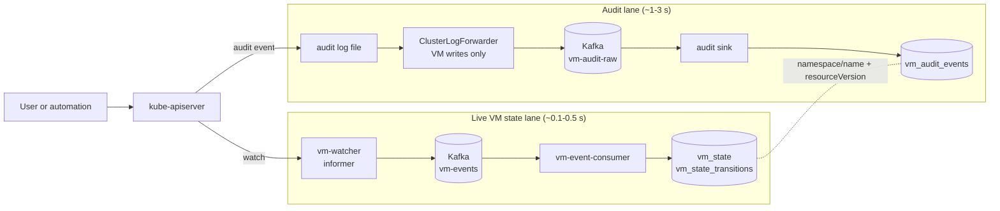

# vm-watcher

KubeVirt VM change pipeline for OpenShift/Kubernetes. Two lanes feed PostgreSQL through one Strimzi Kafka cluster:

- **Live VM state lane (~0.1–0.5 s).** An informer watches `VirtualMachine` objects and publishes every change to Kafka topic `vm-events`. A consumer keeps the current state of each VM in `vm_state` and its status changes in `vm_state_transitions`.
- **Audit lane (~1–3 s).** kube-apiserver audit logs flow through the OpenShift `ClusterLogForwarder` into Kafka topic `vm-audit-raw`. The audit sink stores every VM write request, including the user who made it, in `vm_audit_events`.

Watch events do not say who made a change, so the audit lane stays the record of who did what. Join the lanes on namespace/name and resourceVersion to get both; see [Joining the two lanes](#joining-the-two-lanes).

## What this project includes

- VM watcher (`cmd/vm-watcher`, image `vm-watcher`): informer → Kafka `vm-events`
- VM event consumer (`cmd/vm-event-consumer`, image `vm-event-consumer`): Kafka `vm-events` → `vm_state`, `vm_state_transitions`
- Audit sink (`main.go`, image `vm-audit-sink`): Kafka `vm-audit-raw` → `vm_audit_events`
- kube-apiserver audit log forwarding via OpenShift `ClusterLogForwarder`, filtered to VM write requests on the collector
- Strimzi Kafka (`vm-audit-raw`, `vm-events`) as the durable replay buffer for both lanes
- Dead-letter tables for messages PostgreSQL rejects (`vm_audit_dead_letters`, `vm_event_dead_letters`)
- Health and Prometheus metrics endpoints (`/healthz`, `/metrics`) on every component
- Optional Grafana/Prometheus overlays if you still want them for other workloads

## Prerequisites

- Windows + PowerShell
- Docker Desktop
- `kind`
- `kubectl`
- `kustomize`
- `go` (for local build)

## Quick start

```powershell
.\scripts\setup.ps1
```

This will:

1. Create/reuse kind cluster (`vm-watcher-dev`)
2. Install KubeVirt
3. Install ingress-nginx
4. Build/load `vm-audit-sink:dev`, `vm-watcher:dev` and `vm-event-consumer:dev`
5. Install Strimzi, deploy PostgreSQL, Kafka (topics `vm-audit-raw` and `vm-events`), the audit sink, the watcher and the consumer

Strimzi is pinned to 1.3.0 (`-StrimziVersion`), which runs Kafka 4.2.x and 4.3.x and serves only the `kafka.strimzi.io/v1` API. `deployment/16-kafka.yaml` names Kafka 4.3.1, so change the two together.

The audit forwarder is OpenShift-only and is not applied by the script, so on kind only the live VM state lane carries data. On OpenShift (Logging 6.x), apply it separately:

```powershell
kubectl apply -f deployment/04-clf.yaml
```

## The two lanes



| | Live VM state lane | Audit lane |
|---|---|---|
| Source | Watch on `virtualmachines.kubevirt.io` | kube-apiserver audit log |
| Change → PostgreSQL | ~0.1–0.5 s | ~1–3 s |
| Answers | What state is each VM in, and when did it change? | Who made each write request, and what did they send? |
| Names the user | No | Yes (`username`) |
| Coverage | Every published change. Changes made while the watcher is down collapse into the current state when it restarts | Every successful write request |
| Kafka topic | `vm-events` | `vm-audit-raw` |
| PostgreSQL | `vm_state`, `vm_state_transitions` | `vm_audit_events` |
| Runs on | Any Kubernetes with KubeVirt | OpenShift (Logging 6.x) |

### Expected latency

- **Live VM state lane: ~0.1–0.5 s** from the API server committing a change to the row in `vm_state`. The watch delivers the change within tens of milliseconds. The watcher writes it to Kafka within the 5 ms `BatchTimeout` plus the acknowledgement, and the consumer applies it in one PostgreSQL transaction.
- **Audit lane: ~1–3 s.** The API server writes the audit event to a log file on the control-plane node, and the collector reads that file and ships it to Kafka before the sink sees it. That path cannot go below about 1 s.

| Metric | Lane | What it shows |
|---|---|---|
| `vm_event_publish_lag_seconds` | live | Informer delivered the change → Kafka acknowledged it |
| `vm_event_consumer_event_lag_seconds` | live | Watcher observed the change → `vm_state` committed |
| `audit_sink_event_lag_seconds` | audit | API server finished the request (`stageTimestamp`) → row stored |

p95 for each lane in PromQL:

```promql
histogram_quantile(0.95, sum by (le) (rate(vm_event_consumer_event_lag_seconds_bucket[5m])))
histogram_quantile(0.95, sum by (le) (rate(audit_sink_event_lag_seconds_bucket[5m])))
```

The live lane histograms start when the watcher receives the change, so they leave out the API server → watcher hop (typically tens of milliseconds).

### Joining the two lanes

A watch event carries the object as the API server stored it, including `metadata.resourceVersion`. For a `create`, `update` or `patch`, the audit event's `responseObject` is that same object. So:

> namespace/name + `metadata.resourceVersion` from the watch object = `objectRef` namespace/name + `responseObject.metadata.resourceVersion` in the audit event

Where each lane keeps the key:

| Where | Namespace/name | resourceVersion |
|---|---|---|
| Kafka `vm-events` message | message key `namespace/name` | value field `resourceVersion` |
| `vm_state` (latest change per VM) | `namespace`, `name` | `last_resource_version` |
| `vm_state_transitions` (status changes) | `event_key` (`namespace/name`) | `resource_version` |
| `vm_audit_events` | `namespace`, `name` | `response_object -> 'metadata' ->> 'resourceVersion'` |

`vm_audit_events.resource_version` is not the join key: it is `objectRef.resourceVersion`, the version the client sent with the request (empty for most requests).

Current state of each VM, and who made the request that produced it:

```sql
SELECT s.namespace, s.name, s.last_status, s.last_resource_version, s.last_seen_at,
       a.username, a.verb, a.stage_timestamp
FROM vm_state s
LEFT JOIN vm_audit_events a
  ON  a.namespace = s.namespace
  AND a.name = s.name
  AND a.response_object -> 'metadata' ->> 'resourceVersion' = s.last_resource_version
ORDER BY s.last_seen_at DESC;
```

One VM's history from both lanes, newest first:

```sql
SELECT 'state' AS lane, transition_at AS at, resource_version,
       from_status || ' -> ' || to_status AS what, NULL::text AS username
FROM vm_state_transitions
WHERE event_key = 'team-a/fedora-testvm'
UNION ALL
SELECT 'audit', stage_timestamp, response_object -> 'metadata' ->> 'resourceVersion',
       verb || COALESCE('/' || NULLIF(subresource, ''), ''), username
FROM vm_audit_events
WHERE namespace = 'team-a' AND name = 'fedora-testvm'
ORDER BY at DESC
LIMIT 50;
```

Things to know:

- **Audit profile.** `responseObject` is only in the audit event if the cluster's APIServer audit profile logs request bodies (`WriteRequestBodies` or `AllRequestBodies`); the collector filter cannot add it. Without it, match on namespace/name and time instead. To set it on OpenShift: `oc patch apiserver cluster --type=merge -p '{"spec":{"audit":{"profile":"WriteRequestBodies"}}}'`.
- **Status changes come from KubeVirt.** Changes such as `Starting` → `Running` are written by KubeVirt's controllers, so their resourceVersion joins to an audit event from a KubeVirt service account, not a person. A person's start, stop, restart or migrate goes through `subresources.kubevirt.io` (`subresource` column). That request returns no VM to join on, so match it on namespace/name and the next watch event, usually within a second.
- **Deletes.** KubeVirt puts a finalizer on each VM, so a delete first only sets `deletionTimestamp`. The `delete` audit event's `responseObject` is the VM at that resourceVersion, which the watcher publishes as a `MODIFIED` event. The watch `DELETED` comes later, when KubeVirt removes its finalizer.
- **Filtered updates.** The watcher publishes `MODIFIED` only when the spec (`metadata.generation`), labels, annotations, deletion, printable status or Ready condition change, and filters KubeVirt's status bookkeeping. A person's create, update or patch changes one of those, so it has a matching watch event. A write that changes nothing gets an audit event but no new resourceVersion.

## Live VM state lane

### How it works

1. `vm-watcher` runs a `VirtualMachine` informer per watched namespace (`WATCH_NAMESPACES`, or `*` for the whole cluster).
2. Each add, significant update and delete becomes a JSON `VMEvent`, queued in the order the watch delivered it.
3. A single publisher writes whatever is queued (up to `BATCH_MAX_SIZE`) to `vm-events` with the kafka-go `Writer`. Messages are keyed by `namespace/name` and the `Hash` balancer sends each VM to one partition, so each VM's changes stay in order. `BatchTimeout` is 5 ms instead of kafka-go's 1 s default, and `RequiredAcks` waits for all in-sync replicas.
4. `vm-event-consumer` reads `vm-events` in micro-batches. It applies each batch in one PostgreSQL transaction: dedupe in `consumer_processed_events`, upsert `vm_state`, and insert into `vm_state_transitions` when the status changes, with anomaly flags.

### Event payload

```json
{
  "type": "MODIFIED",
  "namespace": "team-a",
  "name": "fedora-testvm",
  "uid": "a1b2c3d4-...",
  "resourceVersion": "184523",
  "generation": 4,
  "runStrategy": "Always",
  "status": "Running",
  "eventFingerprint": "9f2c...",
  "timestamp": "2026-10-15T10:04:00.123Z",
  "labels": {},
  "annotations": {},
  "spec": {},
  "statusObject": {},
  "disks": []
}
```

`timestamp` is when the watcher observed the change. `eventFingerprint` is a hash of type, namespace, name, uid, resourceVersion, generation, run strategy and status, and identifies the change for deduplication.

### Delivery behavior

Watcher:

- A failed Kafka write is retried with backoff until Kafka acknowledges it. Nothing newer is written in the meantime, so each VM's order holds. While Kafka is down the queue fills and the informer buffers further changes in memory; nothing is dropped.
- On start, the informer lists every VM and publishes `ADDED` for each, so the consumer converges on the current state after a restart or outage. Changes in between are not recovered by this lane; the audit lane has them.
- On shutdown it stops the informers and keeps writing queued events for up to 10 s.
- An event over 1 MB (Kafka's default message size limit) is dropped and counted in `vm_events_dropped_total`, since it could never be written.
- Run one replica. A second one publishes every change twice; the consumer absorbs that but gains nothing.

Consumer:

- Offsets are committed only after the batch is stored, in the background every `KAFKA_COMMIT_INTERVAL`. A replay after a crash is a no-op because `eventFingerprint` is deduplicated in `consumer_processed_events`.
- If PostgreSQL is unavailable, the consumer retries with backoff and does not move past the failed batch. (Committing a later offset would silently skip it.)
- If its tables are missing, for example because PostgreSQL came back on a new, empty volume, the consumer creates them again and retries the batch.
- A message that is not a usable VM event (bad JSON, no `eventFingerprint`, no namespace/name), or one PostgreSQL rejects as invalid (SQLSTATE class 22, 23 or 54), is written to `vm_event_dead_letters` with the error and the raw Kafka payload, and ingest continues.
- **Newest wins.** An event whose resourceVersion is lower than the one stored for the VM is recorded as processed but does not change `vm_state`, and is counted as `stale`. This keeps a late duplicate, from a watcher retry or rollout, from moving a VM backwards. Kubernetes calls resourceVersions opaque, but they come from etcd's revision counter and only grow. After restoring etcd from a backup they start lower, so clear the stored versions with `UPDATE vm_state SET last_resource_version = NULL;`.

### Watcher settings

| Variable | Default | Meaning |
|---|---|---|
| `WATCH_NAMESPACES` | `default` | Comma-separated namespaces, or `*`/`all` for every namespace (needs `01-rbac-cluster.yaml`) |
| `KAFKA_BROKERS` | required | Comma-separated bootstrap brokers |
| `KAFKA_TOPIC` | `vm-events` | Topic to publish to |
| `BATCH_MAX_SIZE` | `100` | Most events per Kafka write |
| `RETRY_INITIAL_BACKOFF` | `200ms` | First wait after a failed Kafka write; doubles on each retry |
| `RETRY_MAX_BACKOFF` | `10s` | Longest wait between retries |
| `RESYNC_PERIOD` | `0` | Informer resync interval; `0` turns resyncs off (they only re-deliver unchanged objects) |
| `HTTP_ADDR` | `:8080` | Address for `/healthz`, `/readyz` (informer caches synced) and `/metrics` |

### Consumer settings

| Variable | Default | Meaning |
|---|---|---|
| `POSTGRES_DSN` | required | PostgreSQL connection string |
| `KAFKA_BROKERS` | required | Comma-separated bootstrap brokers |
| `KAFKA_TOPIC` | `vm-events` | Topic to consume |
| `KAFKA_GROUP_ID` | `vm-event-consumer` | Consumer group shared by all replicas |
| `KAFKA_MAX_WAIT` | `500ms` | Broker long-poll timeout while idle |
| `KAFKA_COMMIT_INTERVAL` | `1s` | Background offset commit interval; `0` commits synchronously after every batch |
| `BATCH_MAX_SIZE` | `500` | Most messages applied per transaction |
| `CONSUMER_NAME` | `vm-event-consumer-1` | Dedupe scope in `consumer_processed_events` |
| `MAX_TRANSITION_GAP` | `30m` | A status change after a longer gap is flagged `large_transition_gap` |
| `RETRY_INITIAL_BACKOFF` | `200ms` | First wait after a failed PostgreSQL write; doubles on each retry |
| `RETRY_MAX_BACKOFF` | `10s` | Longest wait between retries |
| `HTTP_ADDR` | `:8080` | Address for `/healthz` and `/metrics` |

### Metrics

Watcher (`vm-watcher` scrape job in `06-prometheus-config.yaml`):

| Metric | What it shows |
|---|---|
| `vm_event_publish_lag_seconds` | Histogram: informer delivered the change → Kafka acknowledged it |
| `vm_events_observed_total{type,namespace}` | Changes queued for Kafka |
| `vm_events_published_total{type,namespace}` | Changes acknowledged by Kafka |
| `vm_events_publish_failures_total` | Kafka writes that failed and were retried |
| `vm_events_filtered_total{reason,namespace}` | `same_resource_version` (resync) and `insignificant_modified` updates not published |
| `vm_events_dropped_total` | Changes too large for Kafka |
| `vm_event_queue_depth` | Changes waiting for the next write |
| `vm_last_event_unix_seconds{namespace,type}` | Time of the last change Kafka acknowledged |

Consumer (`vm-event-consumer` scrape job):

| Metric | What it shows |
|---|---|
| `vm_event_consumer_event_lag_seconds` | Histogram: watcher observed the change → `vm_state` committed |
| `vm_event_consumer_lag_messages{partition}` | Messages behind the newest one in each partition, as of the last handled message |
| `vm_event_consumer_messages_total{result}` | `applied`, `stale`, `duplicate`, `dead_lettered` |
| `vm_event_consumer_batch_size` | Messages per batch |
| `vm_event_consumer_write_retries_total` | PostgreSQL writes that failed and were retried; rising means ingest is stalled |

### Build and deploy

```powershell
docker build -f .\Dockerfile.watcher -t vm-watcher:dev .
docker build -f .\Dockerfile.consumer -t vm-event-consumer:dev .
kind load docker-image vm-watcher:dev --name vm-watcher-dev
kind load docker-image vm-event-consumer:dev --name vm-watcher-dev
kubectl apply -k .\deployment
kubectl rollout status deployment/vm-watcher -n vm-watcher --timeout=120s
kubectl rollout status deployment/vm-event-consumer -n vm-watcher --timeout=120s
kubectl logs -n vm-watcher deploy/vm-watcher --tail=100
kubectl logs -n vm-watcher deploy/vm-event-consumer --tail=100
```

### Useful queries

```sql
-- current state of every VM
select event_key, last_status, last_event_type, last_resource_version, last_seen_at, total_events
from vm_state
order by last_seen_at desc;

-- latest transitions and anomalies
select event_key, from_status, to_status, resource_version, anomaly, reason, transition_at
from vm_state_transitions
order by transition_at desc
limit 50;

-- messages the consumer could not apply
select kafka_partition, kafka_offset, event_key, error, created_at
from vm_event_dead_letters
order by created_at desc;
```

Or:

```powershell
.\scripts\inspect-sink.ps1 -SinkType postgres -Tail 20   # vm_state
.\scripts\inspect-sink.ps1 -SinkType kafka -Tail 20      # raw vm-events messages
```

## Audit lane

### Architecture

This lane uses an audit-log write path:

1. kube-apiserver emits authoritative audit events for every mutating VM request.
2. OpenShift `ClusterLogForwarder` (Logging 6.x) forwards only VirtualMachine write requests from the kube-apiserver audit log to Kafka topic `vm-audit-raw`. A `kubeAPIAudit` filter on the collector drops everything else (reads, other resources, node auditd, OpenShift/OAuth API servers) before it reaches Kafka.
3. The audit sink reads Kafka in micro-batches and keeps successful `create`, `update`, `patch`, `delete` and `deletecollection` requests for `virtualmachines` in `kubevirt.io` and `subresources.kubevirt.io`. The second group carries start/stop/restart/migrate; it is the only place the user behind those actions appears (`subresource` column).
4. PostgreSQL enforces global dedupe with `auditID` as the primary key.
5. Kafka provides the durable replay buffer; PostgreSQL remains the queryable store.

Request and response bodies are only stored if the cluster's APIServer audit profile logs them (`WriteRequestBodies` or `AllRequestBodies`); the collector filter can drop detail but never add it.

### Delivery behavior

- Multiple sink replicas can share the same Kafka consumer group.
- Kafka partitions provide parallelism; one partition is owned by one consumer at a time.
- Offsets are committed only after the batch's VM events are stored. Commits are sent in the background every `KAFKA_COMMIT_INTERVAL`; after a crash, at most that window is replayed.
- Duplicate event rows are prevented in PostgreSQL by `ON CONFLICT (audit_id) DO NOTHING`, so replays are harmless.
- If PostgreSQL is unavailable, the sink retries with backoff and does not move past the failed event. (Committing a later offset would silently skip it.)
- If its tables are missing, for example because PostgreSQL came back on a new, empty volume, the sink creates them again and retries.
- An event PostgreSQL rejects as invalid (SQLSTATE class 22, 23 or 54, for example a `\u0000` inside JSONB) can never succeed. It is written to `vm_audit_dead_letters` with the error and the raw Kafka payload, and ingest continues.

### Low-latency ingest

- Filtering happens on the collector, so the sink never queues VM events behind the rest of the cluster's audit traffic.
- Micro-batching: each batch is whatever is already fetched, up to `BATCH_MAX_SIZE`. A lone event is written immediately; under load the batches grow instead of a backlog. One batch is one PostgreSQL round trip.
- `KAFKA_MAX_WAIT` is the broker long-poll timeout while the topic is idle. It does not delay new messages.
- The sink still pre-filters with a cheap byte search and checks `stage`, verb, `objectRef.resource`, `objectRef.apiGroup` and HTTP status, so it also works with an unfiltered forwarder.

### Sink settings

| Variable | Default | Meaning |
|---|---|---|
| `POSTGRES_DSN` | required | PostgreSQL connection string |
| `KAFKA_BROKERS` | required | Comma-separated bootstrap brokers |
| `KAFKA_TOPIC` | `vm-audit-raw` | Topic to consume |
| `KAFKA_GROUP_ID` | `vm-audit-sink` | Consumer group shared by all replicas |
| `KAFKA_MAX_WAIT` | `500ms` | Broker long-poll timeout while idle |
| `KAFKA_COMMIT_INTERVAL` | `1s` | Background offset commit interval; `0` commits synchronously after every batch |
| `BATCH_MAX_SIZE` | `500` | Most messages handled per batch |
| `RETRY_INITIAL_BACKOFF` | `200ms` | First wait after a failed PostgreSQL write; doubles on each retry |
| `RETRY_MAX_BACKOFF` | `10s` | Longest wait between retries |
| `HTTP_ADDR` | `:8080` | Address for `/healthz` and `/metrics` |

### Measuring latency

`/metrics` (scraped by the `audit-sink` job in `06-prometheus-config.yaml`) exposes:

| Metric | What it shows |
|---|---|
| `audit_sink_event_lag_seconds` | Histogram: API server finished the request (`stageTimestamp`) → row stored |
| `audit_sink_consumer_lag_messages{partition}` | Messages behind the newest one in each partition, as of the last handled message |
| `audit_sink_messages_total{result}` | `stored`, `duplicate`, `filtered`, `malformed`, `dead_lettered` |
| `audit_sink_batch_size` | Messages per batch |
| `audit_sink_write_retries_total` | PostgreSQL writes that failed and were retried; rising means ingest is stalled |

p95 end-to-end latency in PromQL:

```promql
histogram_quantile(0.95, sum by (le) (rate(audit_sink_event_lag_seconds_bucket[5m])))
```

The same from PostgreSQL (assumes control-plane and database clocks are in sync via NTP):

```sql
SELECT percentile_cont(0.5)  WITHIN GROUP (ORDER BY created_at - stage_timestamp) AS p50,
       percentile_cont(0.95) WITHIN GROUP (ORDER BY created_at - stage_timestamp) AS p95,
       max(created_at - stage_timestamp) AS worst
FROM vm_audit_events
WHERE created_at > now() - interval '1 hour';
```

## PostgreSQL persistence, backup, and restore

### Persistent data volume

PostgreSQL uses a persistent volume claim:

- PVC name: `postgres-data`
- Namespace: `vm-watcher`
- Requested size: `20Gi`

This means PostgreSQL data is not lost when the pod/container restarts.

### Check PVC status

```powershell
kubectl get pvc -n vm-watcher
kubectl describe pvc postgres-data -n vm-watcher
```

### Backup (export)

Use the helper script:

```powershell
.\scripts\backup-postgres.ps1
```

Optional destination:

```powershell
.\scripts\backup-postgres.ps1 -OutputDir .\backups
```

The script creates a PostgreSQL custom-format dump (`.dump`) that you can copy to external storage (NAS/object storage/file share).

### Restore (import)

Use the helper script:

```powershell
.\scripts\restore-postgres.ps1 -BackupFile .\backups\vmwatcher-backup-YYYYMMDD-HHMMSS.dump
```

Restore behavior:

- Uses `pg_restore`
- Includes `--clean --if-exists` to replace existing objects safely

### Scheduled automatic backups (CronJob)

The deployment includes:

- CronJob: `postgres-backup`
- Backup PVC: `postgres-backups`
- Schedule: every 6 hours (`0 */6 * * *`)
- Retention: 7 days (`BACKUP_RETENTION_DAYS`)

Backup verification:

- CronJob: `postgres-backup-verify`
- Schedule: every 6 hours, offset by 30 minutes (`30 */6 * * *`)
- Validates the newest `.dump` backup with `pg_restore --list`

Check backup scheduler state:

```powershell
kubectl get cronjob -n vm-watcher
kubectl get jobs -n vm-watcher
kubectl get pvc postgres-backups -n vm-watcher
```

Run one backup immediately:

```powershell
kubectl create job --from=cronjob/postgres-backup postgres-backup-manual -n vm-watcher
kubectl logs -n vm-watcher job/postgres-backup-manual
```

Run one verification immediately:

```powershell
kubectl create job --from=cronjob/postgres-backup-verify postgres-backup-verify-manual -n vm-watcher
kubectl logs -n vm-watcher job/postgres-backup-verify-manual
```

List files on backup PVC (helper pod):

```powershell
kubectl run backup-shell -n vm-watcher --image=busybox:1.36 --restart=Never --overrides '{"spec":{"volumes":[{"name":"b","persistentVolumeClaim":{"claimName":"postgres-backups"}}],"containers":[{"name":"backup-shell","image":"busybox:1.36","command":["sh","-c","sleep 3600"],"volumeMounts":[{"name":"b","mountPath":"/backups"}]}]}}'
kubectl wait --for=condition=Ready pod/backup-shell -n vm-watcher --timeout=60s
kubectl exec -n vm-watcher backup-shell -- ls -lh /backups
```

Copy one backup file locally:

```powershell
kubectl cp vm-watcher/backup-shell:/backups/vmwatcher-backup-YYYYMMDD-HHMMSS.dump .\backups\
kubectl delete pod backup-shell -n vm-watcher
```

Helper scripts:

```powershell
./scripts/run-postgres-backup-job.ps1
./scripts/run-postgres-backup-verify-job.ps1
```

### Optional one-time in-cluster SQL backup file

```powershell
$pod = kubectl get pod -n vm-watcher -l app=postgres -o jsonpath="{.items[0].metadata.name}"
kubectl exec -n vm-watcher $pod -- sh -lc "pg_dump -U vmwatcher -d vmwatcher > /tmp/vmwatcher.sql"
kubectl cp "vm-watcher/$pod:/tmp/vmwatcher.sql" .\vmwatcher.sql
```

## Access

Add hosts entries (run as Administrator):

```powershell
Add-Content -Path "$env:SystemRoot\System32\drivers\etc\hosts" -Value "127.0.0.1 grafana.local prometheus.local"
```

Open:

- Grafana: `http://grafana.local` (admin/admin)
- Prometheus: `http://prometheus.local`
- Health: `http://localhost:8080/healthz` (vm-watcher)

If needed on an existing cluster without host port mapping:

```powershell
kubectl port-forward -n ingress-nginx svc/ingress-nginx-controller 80:80
```

## VM examples

### Fedora VM

```powershell
kubectl apply -f .\deployment\05-example-vm.yaml
kubectl patch vm fedora-testvm -n team-a --type=merge -p '{"spec":{"runStrategy":"Always"}}'
```

### Alpine VM

```powershell
kubectl apply -f .\deployment\06-alpine-testvm.yaml
kubectl patch vm alpine-testvm -n team-b --type=merge -p '{"spec":{"runStrategy":"Always"}}'
```

### Windows VM (DataVolume import flow)

1. Set a valid Windows image URL in `deployment/12-example-windows-datavolume.yaml` (or pass `-WindowsImageUrl`).
1. Run:

```powershell
.\scripts\setup.ps1 -CreateWindowsExampleVM $true -CreateWindowsDataVolume $true -WindowsImageUrl "https://YOUR_WINDOWS_IMAGE.qcow2"
```

1. Wait for import:

```powershell
kubectl get dv -n team-b windows-rootdisk -w
```

1. Start VM:

```powershell
kubectl patch vm windows-testvm -n team-b --type=merge -p '{"spec":{"runStrategy":"Always"}}'
```

## Dashboards

The Grafana overlay (`06`–`09` manifests) is not part of `kustomization.yaml`. Its folder **VM Watcher** has:

- VM Watcher - Lifecycle Overview (watcher metrics)
- VM Watcher - Per Namespace Changes (watcher metrics)
- VM Watcher - PostgreSQL Events (reads the `vm_events` table of the retired file-and-sidecar path, so it stays empty)
- VM Watcher - Consumer State & Anomalies (`vm_state`, `vm_state_transitions`; its Consumer Lag panel also reads the retired tables, so use `vm_event_consumer_lag_messages` instead)

## Important notes

- This repo is currently Postgres-first for sink usage.
- Windows VM bootability depends on a valid, licensed Windows disk image and successful DataVolume import.
- In nested virtualization-constrained environments, KubeVirt uses emulation mode in setup.
