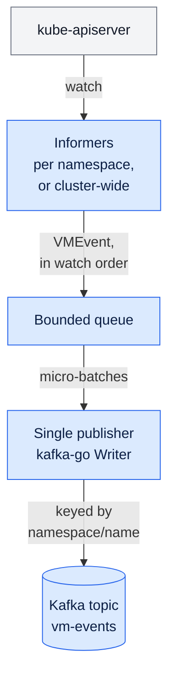

# vm-watcher

Watches KubeVirt / OpenShift Virtualization `VirtualMachine` resources in a
configured set of namespaces and publishes **create / update / delete** events
to Kafka topic `vm-events`. It is the first half of the live VM state lane;
`cmd/vm-event-consumer` stores the events in PostgreSQL. See
[README.md](README.md) for both lanes, settings, metrics, and how to join this
lane to the audit lane.

Edge-triggered event forwarder — each watch event is transformed into a compact
`VMEvent` and published. Designed as an event feed, **not** a state-convergence
operator. See [Design notes](#design-notes) for why.

---

## What it does

- Watches `kubevirt.io/v1` `VirtualMachine` objects via namespace-scoped informers
  (or one cluster-wide informer for `WATCH_NAMESPACES=*`).
- Emits one event per change: `ADDED`, `MODIFIED`, `DELETED`.
- Publishes to Kafka keyed on `namespace/name`, so per-VM event ordering is preserved.
- Handles informer tombstones (missed deletes) and drops resync duplicates and
  status-only bookkeeping updates.
- Retries a failed Kafka write until it succeeds, without writing anything newer
  in the meantime; a flapping broker never blocks the watch.

---

## Architecture



- **Informers:** one factory per namespace, or one cluster-wide informer for
  `WATCH_NAMESPACES=*`. Their add, update and delete handlers turn each watch
  event into a `VMEvent`.
- **Bounded queue:** when it is full, the handlers wait and the informer buffers
  further changes in memory.
- **Single publisher:** writes micro-batches of up to `BATCH_MAX_SIZE` events
  with a kafka-go Writer: Hash balancer on the `namespace/name` key,
  `BatchTimeout` 5 ms, `RequireAll` acks.

One publisher, not a worker pool: two workers could write two changes to the
same VM out of order.

---

## Configuration

All configuration is via environment variables. The full table is in
[README.md](README.md#watcher-settings).

| Variable | Default | Description |
|---|---|---|
| `WATCH_NAMESPACES` | `default` | Comma-separated namespaces to watch, or `*` for all |
| `KAFKA_BROKERS` | required | Comma-separated broker addresses |
| `KAFKA_TOPIC` | `vm-events` | Destination topic |
| `BATCH_MAX_SIZE` | `100` | Most events per Kafka write |
| `RESYNC_PERIOD` | `0` | Informer resync interval; `0` turns resyncs off |

---

## Event payload

```json
{
  "type": "MODIFIED",
  "namespace": "team-a",
  "name": "web-vm-01",
  "uid": "a1b2c3d4-...",
  "resourceVersion": "184523",
  "generation": 4,
  "runStrategy": "Always",
  "status": "Running",
  "eventFingerprint": "9f2c...",
  "timestamp": "2026-10-15T10:04:00.123Z"
}
```

The full payload also carries labels, annotations, owner references, `spec`,
`statusObject` and `disks`. `uid` + `resourceVersion` identify the object
version, and `eventFingerprint` lets consumers **dedupe** — delivery is
at-least-once (see [Delivery guarantees](#delivery-guarantees)).

---

## Build & run

### Local (uses `$KUBECONFIG` or `~/.kube/config`)

```bash
WATCH_NAMESPACES=team-a,team-b KAFKA_BROKERS=localhost:9092 go run ./cmd/vm-watcher
```

### Container

```bash
docker build -f Dockerfile.watcher -t registry.example.com/vm-watcher:latest .
docker push registry.example.com/vm-watcher:latest
```

### Deploy

```bash
kubectl apply -k deployment/
```

The watcher is `deployment/04-vm-watcher.yaml`. Set `WATCH_NAMESPACES` there and
add a `Role` + `RoleBinding` in `deployment/01-rbac.yaml` **once per watched
namespace**.

---

## RBAC

Deliberately **namespace-scoped** — the service only does namespaced LIST/WATCH,
so no `ClusterRole` is required (least privilege). One `Role` + `RoleBinding`
per watched namespace, all bound to a single `ServiceAccount` in the
`vm-watcher` namespace. `WATCH_NAMESPACES=*` needs `deployment/01-rbac-cluster.yaml`
instead.

```
get, list, watch  on  kubevirt.io/virtualmachines
```

Add `virtualmachineinstances` to the resource list if you switch to watching
runtime (pod-level) lifecycle instead of the VM spec.

---

## Design notes

### Watch-based forwarder vs operator pattern

This service is intentionally an **edge-triggered event forwarder**, not a
controller-runtime operator. The two solve different problems:

| Dimension | Watch-Based Forwarder (this) | Operator Pattern |
|---|---|---|
| What it does | Forwards each VM create/update/delete to the queue | Reconciles VM state toward a desired state |
| Best fit for | Event stream / audit feed / notifications | Owning & acting on a resource's lifecycle |
| Event fidelity | Preserves exact create/update/delete + every transition | Collapses events; can silently coalesce rapid changes |
| Delete guarantees | Best-effort; an event can be lost on a crash | Can guarantee action before deletion (via finalizer) |
| Self-healing on restart | Re-lists; replays existing VMs as "added" | Re-lists and converges to correct state |
| High availability | Needs leader election added (single replica today) | Built-in leader election |
| Build / maintenance effort | Low — small single-purpose service | Higher — heavier framework, more moving parts |
| Operational footprint | Minimal (one binary, small image) | Larger (manager, scheme, webhooks) |
| Delivery semantics | At-least-once; consumers dedupe | At-least-once; convergence-based |

**Why watch-based is the right fit here:** the goal is to forward a faithful
stream of VM events to a queue. An operator's reconcile loop is level-triggered
and coalescing — it would discard the create-vs-update distinction and can drop
rapid intermediate changes, which works against an event feed.

**Switch to an operator only if** one of these becomes a requirement:
- Guaranteed handling on delete (needs a finalizer).
- The service starts **mutating** VMs rather than just observing them.

### Delivery guarantees

Delivery is **at-least-once**, not exactly-once:
- A failed Kafka write is retried until Kafka acknowledges it, so a broker
  outage delays events but does not drop them.
- Events still queued when the process stops (after a 10 s drain on shutdown,
  or on a crash) are lost. The next start re-lists every VM, so the latest state
  still arrives; only the intermediate changes are missing.
- An event over 1 MB (Kafka's default message limit) is dropped and counted in
  `vm_events_dropped_total`.

Consumers must dedupe on `eventFingerprint` (or `uid` + `resourceVersion`).
`cmd/vm-event-consumer` does, and also ignores an event older than the state it
has stored for that VM.

### High availability

Runs at **`replicas: 1`** by design — multiple replicas would publish every
event multiple times. For HA, add leader election
(`k8s.io/client-go/tools/leaderelection`) so only the leader publishes.

### Restart behaviour

On startup the informer LISTs all existing VMs and fires `ADDED` for each. The
consumer applies them as the current state; their fingerprints differ from the
earlier `MODIFIED` events, so they are not dropped as duplicates.

### Filtering status noise

KubeVirt updates `status` often. A `MODIFIED` event is published only when the
spec (`metadata.generation`), labels, annotations, deletion, `printableStatus`
or the `Ready` condition change. Other updates are counted in
`vm_events_filtered_total{reason="insignificant_modified"}`.

---

## Health

- `GET /healthz` on `:8080` — liveness.
- `GET /readyz` — readiness; ready once the informer caches have synced.
- `GET /metrics` — Prometheus metrics.
